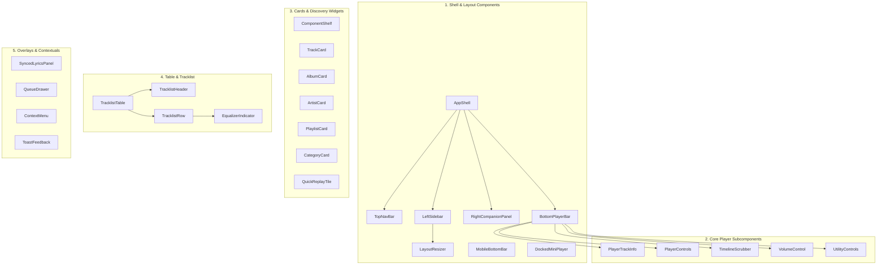

# SONORA — Component Inventory & Design System Taxonomy

**Document Version:** 1.0.0  
**Status:** Architectural Proposal (Awaiting Approval)  
**Author:** Senior Product Architect  
**Project Root:** `D:\SONORA`

---

## 1. Design Tokens & Foundations

SONORA uses a refined dark-mode aesthetic rooted in high-contrast accessibility and ambient visual response.

### 1.1 Color Palette Tokens

| Token Name | Hex Value | Purpose / Role |
|---|---|---|
| `bg-base` | `#000000` | Deep black background for main root canvas and window borders. |
| `bg-surface` | `#121212` | Default background for sidebar, main view cards, and player bar. |
| `bg-elevated-base` | `#181818` | Elevated card surfaces and floating panels. |
| `bg-elevated-highlight` | `#282828` | Hover state for cards and list items. |
| `bg-tinted-highlight` | `rgba(255, 255, 255, 0.07)` | Active table row and selected button background. |
| `accent-emerald` | `#10b981` | SONORA's signature accent: active play buttons, toggles, and scrubber progress. |
| `accent-emerald-hover` | `#059669` | Hover state for primary action buttons. |
| `text-primary` | `#ffffff` | High-contrast headers, active track titles, and active lyrics. |
| `text-subdued` | `#a7a7a7` | Secondary metadata (artists, album names, durations, timestamps). |
| `text-muted` | `#6b7280` | Placeholder text, disabled buttons, and copyright notices. |
| `border-subtle` | `rgba(255, 255, 255, 0.08)` | Dividers, splitters, and modal borders. |

---

## 2. Component Taxonomy & Inventory



---

## 3. Comprehensive Component Specifications

### 3.1 Layout & Shell

#### `AppShell`
- **Location:** `src/layouts/AppShell.tsx`
- **Purpose:** Master responsive layout grid managing columns and viewport height.
- **Props:** `children: React.ReactNode`
- **States:** Observes `sidebarWidth`, `rightPanelMode`, `isMobile`.
- **CSS Grid:**
  ```css
  grid-template-rows: auto 1fr auto;
  grid-template-columns: var(--sidebar-width, 300px) 1fr var(--right-panel-width, 0px);
  gap: 8px;
  ```

#### `TopNavBar`
- **Location:** `src/layouts/TopNavBar.tsx`
- **Purpose:** Global header containing logo, navigation history (Back/Forward), Search capsule, and user avatar.
- **Micro-Interactions:** Back/Forward buttons disable when history is at boundary; Search input expands smoothly on focus.

#### `LeftSidebar` & `LayoutResizer`
- **Location:** `src/layouts/LeftSidebar.tsx`, `src/components/common/LayoutResizer.tsx`
- **Purpose:** Resizable container for "Your Library" with drag splitter.
- **Controls:** Filter pills ("Playlists", "Artists", "Albums"), Create Playlist '+' button, search filter.
- **Resizer Behavior:** Draggable handle with `cursor: col-resize`, emitting pointer events with `setPointerCapture`. Range clamped to `240px`–`420px`. Double-clicking resets to default `300px`.

#### `BottomPlayerBar`
- **Location:** `src/layouts/BottomPlayerBar.tsx`
- **Purpose:** Fixed bottom audio controller bar.
- **Layout:** 3 zones (Left: 30%, Center: 40%, Right: 30%) with flex distribution.
- **Z-Index:** `z-40` with solid surface background and top 1px border.

---

### 3.2 Core Player Subcomponents

#### `TimelineScrubber`
- **Location:** `src/components/player/TimelineScrubber.tsx`
- **Purpose:** Visual representation of playback progress, duration, and seek slider.
- **Features:**
  - Buffered progress background bar.
  - Accent-colored elapsed progress fill bar.
  - Circular thumb handle (`progress-bar-handle`), hidden by default, scaling up on slider hover.
  - Hover timestamp tooltip showing target seek position.
  - Throttled seek event to prevent audio buffer glitches.

#### `PlayerControls`
- **Location:** `src/components/player/PlayerControls.tsx`
- **Purpose:** Primary playback buttons.
- **Buttons:**
  - `Shuffle`: Toggles random queue; active state has green accent and dot indicator.
  - `Previous`: Skips to previous track or restarts current track (>3s).
  - `Play/Pause`: 36px white circle with black icon; scales up to `1.05` on hover, `0.95` on press.
  - `Next`: Advances to next track in queue.
  - `Repeat`: 3-state toggle (Off / Repeat List / Repeat One with '1' badge).

#### `VolumeControl`
- **Location:** `src/components/player/VolumeControl.tsx`
- **Purpose:** Volume management slider with mute button.
- **Icons:** Dynamically switches between `VolumeX` (0%), `Volume1` (1-49%), and `Volume2` (50-100%).

---

### 3.3 Cards & Content Shelves

#### `ComponentShelf`
- **Location:** `src/components/cards/ComponentShelf.tsx`
- **Purpose:** Reusable horizontal scroll container for cards.
- **Props:**
  ```typescript
  interface ComponentShelfProps {
    title: string;
    seeAllHref?: string;
    children: React.ReactNode;
  }
  ```
- **Interactions:** Displays circular `<ChevronLeft>` and `<ChevronRight>` pagination buttons on shelf hover; clicking smoothly animates horizontal scroll by 80% container width.

#### `TrackCard`, `AlbumCard`, `ArtistCard`
- **Location:** `src/components/cards/`
- **Visuals:**
  - `TrackCard` / `AlbumCard`: Square artwork with 8px radius.
  - `ArtistCard`: Circular avatar with verified badge.
- **Hover Micro-Interaction:**
  - Card background brightens (`#181818` -> `#282828`).
  - Floating green Play Action Button slides up from bottom-right (`opacity: 0 -> 1`, `translateY(8px) -> translateY(0)`).
  - Title and subtitle clamp to 2 lines max with ellipsis.

#### `CategoryCard`
- **Location:** `src/components/cards/CategoryCard.tsx`
- **Purpose:** Browse genre tile.
- **Visuals:** Bold colored card with a 45-degree angled cover image tucked into the bottom-right corner.

---

### 3.4 Tracklist Table Components

#### `TracklistTable` & `TracklistRow`
- **Location:** `src/components/table/TracklistTable.tsx`, `src/components/table/TracklistRow.tsx`
- **Grid Layout:**
  `grid-template-columns: [index] 48px [title] 4fr [album] 3fr [date] 2fr [duration] 120px;`
- **Row States:**
  - *Default:* Shows track index number `#`.
  - *Row Hover:* Index `#` turns into a white Play triangle icon; Heart button and 3-dots menu button appear on the right.
  - *Currently Playing:* Song title turns Emerald (`#10b981`); track index is replaced by an animated 3-bar soundwave equalizer (`EqualizerIndicator`).
  - *Double Click:* Triggers immediate playback of this track within the parent playlist context.

---

### 3.5 Companion Panels & Modal Overlays

#### `SyncedLyricsPanel`
- **Location:** `src/components/lyrics/SyncedLyricsPanel.tsx`
- **Presentation:** Dual-mode (Companion in Right Panel or Full-Screen Overlay).
- **Features:**
  - Dynamically extracts album dominant color for ambient background glow.
  - Maps through `lyrics: LyricLine[]`.
  - Active line renders in bold white with smooth scaling; inactive lines dimmed.
  - Click any line to seek directly to `line.timeMs`.
  - `useLyricsSync` hook auto-scrolls container to keep active line vertically centered.

#### `QueueDrawer`
- **Location:** `src/components/queue/QueueDrawer.tsx`
- **Features:**
  - Tab 1: Current Queue (Now Playing, Next in Queue, Source Tracks).
  - Tab 2: Recently Played History.
  - Drag-and-drop reordering with Framer Motion `Reorder.Group` and `Reorder.Item`.
  - "Clear Queue" action button.

#### `DockedMiniPlayer` & `FullScreenMobilePlayer`
- **Location:** `src/components/mobile/`
- **Behavior:**
  - `DockedMiniPlayer`: Anchored 54px bar on mobile above bottom tab navigation.
  - Tapping opens `FullScreenMobilePlayer` via slide-up spring animation with drag-to-dismiss handle.

---

## 4. Component Props & TypeScript Interfaces Summary

| Component | Key Props | Store Subscriptions |
|---|---|---|
| `AppShell` | `children` | `useUIStore.sidebarWidth`, `useUIStore.rightPanelMode` |
| `BottomPlayerBar` | None | `useAudioStore.currentTrack`, `useAudioStore.isPlaying` |
| `TimelineScrubber` | None | `useAudioStore.currentTime`, `useAudioStore.duration` |
| `ComponentShelf` | `title`, `seeAllHref`, `items` | None (pure presentation) |
| `TracklistTable` | `tracks`, `showHeader`, `contextUri` | `useAudioStore.currentTrack.id`, `useAudioStore.isPlaying` |
| `SyncedLyricsPanel` | `track`, `isFullScreen` | `useAudioStore.currentTime` |
| `QueueDrawer` | None | `useAudioStore.queue`, `useAudioStore.currentTrack` |
| `CategoryCard` | `category: GenreCategory` | None |
| `ToastFeedback` | None | `useUIStore.activeToast` |

---

*All components are engineered to adhere strictly to WCAG 2.1 AA accessibility guidelines, utilizing Radix headless primitives and pure Tailwind CSS styling.*
