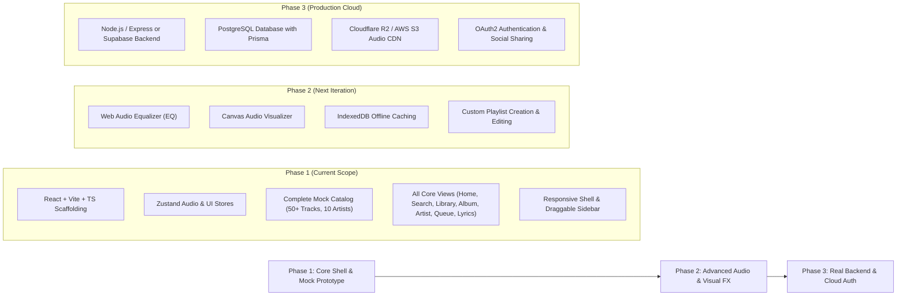

# SONORA — Product Requirements Document (PRD)

**Document Version:** 1.0.0  
**Status:** Architectural Proposal (Awaiting Approval)  
**Author:** Senior Product Architect  
**Project Root:** `D:\SONORA`  
**Target Release:** v1.0 (Local-First High-Fidelity Prototype)

---

## 1. Product Vision & Value Proposition

**SONORA** is an original, premium, web-native music streaming application designed for deep listeners, curators, and audio enthusiasts. While inspired by the fluid ergonomics and familiar layouts of market leaders like Spotify, SONORA distinguishes itself through:

1. **Ambient Visual Resonance:** A dynamic aesthetic engine that extracts color palettes from album artwork, transforming the entire application shell, lyrics backdrop, and player controls into an organic, breathing visual extension of the music.
2. **Zero-Latency Ergonomics:** An uncompromising single-page architecture where audio playback never halts, stutters, or resets during navigation, filtering, or modal interactions.
3. **Tactile Micro-Interactions:** Smooth spring physics, floating action buttons, interactive scrubber timeline previews, and resizable layout zones designed with attention to every pixel.
4. **Local-First Extensibility:** Complete functional autonomy in v1.0 powered by structured local mock catalogs, engineered with strict data layer abstraction to allow seamless drop-in integration with real streaming APIs and databases in future phases.

---

## 2. Target Users & Personas

| Persona | Archetype | Needs & Pain Points | Key SONORA Features Used |
|---|---|---|---|
| **Elena, 24** | *The Active Explorer* | Constantly seeks new genres and curated vibes; wants fast searching without cognitive friction; expects instant music playback. | Home shelves, Genre & Mood browse tiles, predictive instant search combobox, floating quick-play buttons. |
| **Marcus, 32** | *The Deep Listener* | Values lyrics, production credits, album liner notes, and immersive visuals; listens to entire albums end-to-end. | Synced karaoke-style lyrics view, dynamic ambient lighting, expanded Now Playing view, high-contrast typography. |
| **Devon, 28** | *The Precision Curator* | Builds hyper-specific playlists; needs quick queue manipulation, drag-and-drop reordering, and flexible library sorting. | Resizable library sidebar, customizable playlist view, interactive drag-and-drop queue, multi-column tracklists. |

---

## 3. Core Features & Functional Requirements

### 3.1 Persistent Global Player Shell (P0 - Critical)
- **Audio Engine:** Non-blocking HTML5 Audio / Web Audio API playback controller running at the root layout.
- **Controls Zone:**
  - Play/Pause with smooth state morphing icon.
  - Previous / Next track with smart previous behavior (first 3 seconds jumps to previous track; after 3 seconds resets current track to `0:00`).
  - Shuffle toggle with deterministic seed-shuffle algorithm and active indicator dot.
  - Repeat toggle with 3 states: `Off` -> `Repeat All` -> `Repeat One` (with badge `1`).
  - Volume slider with mute memory and icon states (`VolumeX`, `Volume1`, `Volume2`).
- **Interactive Scrubber:**
  - Progress bar reflecting current elapsed time and total duration in `m:ss`.
  - Buffer progress indicator showing loaded audio data.
  - Scrubbing without audio distortion: smooth seek on drag release or real-time throttled seek.
  - Hover tooltip displaying timestamp target.
- **Track Identity Widget:**
  - 56×56 thumbnail with expand button for Right Panel.
  - Title and Artist links with auto-marquee scroll on text overflow.
  - Quick Like/Favorite toggle button with heart animation.

### 3.2 Dynamic Ambient Theme Engine (P1 - High)
- **Artwork Palette Extraction:** Real-time extraction of dominant color, primary accent, and subdued background tone upon track load using Canvas pixel sampling.
- **Adaptive Shell Glow:** Subtle radial ambient gradient applied behind the active page hero, main view header, and lyrics backdrop.
- **Contrast Guard:** Automated luminance calculation ensuring all typography and interactive icons maintain WCAG AA contrast (minimum 4.5:1) against generated backgrounds.

### 3.3 Dynamic Home Experience (P1 - High)
- **Time-Aware Header:** Contextual greeting ("Good morning", "Good afternoon", "Good evening") with 6 quick-access compact cards (recently played or top mixes).
- **Categorized Shelves:** Horizontal carousels with smooth snap-scroll for:
  - "Made For You" (personalized algorithmic mock mixes).
  - "Trending Now" (top regional hits).
  - "Popular Albums & Singles".
  - "Featured Playlists".
- **Hover Micro-Interactions:** Cards elevate with drop shadows and reveal an animated floating emerald Play button (`translateY(8px)` -> `translateY(0)`, `opacity: 0` -> `1`).

### 3.4 Predictive Search & Category Browse (P1 - High)
- **Search Capsule:** Centered global input with `role="combobox"` and instant clear ('X') trigger.
- **Category Browse Grid (Empty State):** 16+ colorful genre and mood cards (Pop, Hip-Hop, Indie, Electronic, Focus, Chill, Rock) with 25-degree rotated preview art.
- **Live Search Suggestions (Active State):** Debounced (200ms) query matching across local catalog returning:
  - Top Result card with direct play trigger.
  - Top 4 matching Songs with play counts and duration.
  - Matching Artists with circular avatars.
  - Matching Albums and Playlists.

### 3.5 Rich Playlist & Album Experiences (P1 - High)
- **Hero Banner:** Full-bleed gradient background matching cover art, displaying cover image (232×232), entity type ("Public Playlist" or "Album"), title in clamp typography, creator avatar and name, song count, and total duration.
- **Action Ribbon:** Primary 56px circular Play button, Like/Save button, and contextual More Options menu.
- **Tracklist Table (`role="grid"`):**
  - Columns: `#` (Index / Play icon on hover / animated equalizer when active), `Title & Artist`, `Album`, `Date Added`, `Duration`.
  - Double-click to play any row.
  - Row hover reveals Favorite Heart button and More Options button.

### 3.6 Comprehensive Artist Discography (P1 - High)
- **Artist Hero Banner:** High-resolution panoramic cover with verified badge and formatted monthly listeners count.
- **Popular Tracks Section:** Top 5 tracks (expandable to 10) with play count metrics and duration.
- **Categorized Releases:** Filter tabs for "Albums", "Singles & EPs", and "Compilations".
- **Artist About Card:** High-res bio card with global ranking, biography text, and social links.

### 3.7 Interactive Queue Interface (P1 - High)
- **Queue Panel / View:** Accessible via bottom player bar icon or `/queue` route.
- **Sections:**
  - "Now Playing": Currently active song with progress.
  - "Next in Queue": User-added songs with "Clear queue" trigger.
  - "Next from [Source]": Remaining tracks from current playlist/album.
- **Interactions:** Drag-to-reorder tracks, remove individual items, or jump directly to any track in queue.

### 3.8 Synced Ambient Lyrics Experience (P2 - Medium)
- **Presentation:** Full-screen ambient view and right-panel companion view.
- **Interactive Karaoke Sync:** Active line highlighted in high-contrast white with subtle font scale; past and future lines dimmed with smooth opacity transitions.
- **Click-to-Seek:** Clicking any lyric line immediately seeks the audio player to that precise timestamp.
- **Auto-Scroll Engine:** Smoothly centers active lyric line in viewport as audio time progresses.

### 3.9 Resizable Layout & Responsive Adaptation (P0 - Critical)
- **Desktop (>1024px):** 3-column layout. Left Library sidebar is user-resizable between 280px and 420px via draggable splitter. Right Now Playing panel toggles open/closed.
- **Tablet (768px - 1023px):** Left sidebar automatically collapses to compact 64px icon rail. Right panel converts to slide-over modal.
- **Mobile (<768px):** Desktop sidebars hidden; bottom navigation bar enabled (Home, Search, Your Library); persistent mini-player docked above bottom nav; tapping mini-player opens full-screen player modal.

---

## 4. Non-Functional Requirements

### 4.1 Performance & Frame Budget
- **Interaction Latency:** Input and button reactions strictly under **50ms**.
- **Animation Smoothness:** All transitions, carousels, and hover states rendered at solid **60fps** using hardware-accelerated transforms (`transform`, `opacity`).
- **Memory Footprint:** Audio buffers and image assets lazily loaded; unmounted views purged from memory.

### 4.2 Accessibility & Usability (WCAG 2.1 Level AA)
- Semantic HTML landmarks (`<nav>`, `<header>`, `<main>`, `<aside>`, `<footer>`).
- Full keyboard operability:
  - `Space`: Play / Pause toggle.
  - `ArrowLeft` / `ArrowRight`: Seek -5s / +5s.
  - `ArrowUp` / `ArrowDown`: Volume +/- 5%.
  - `M`: Mute toggle.
  - `L`: Lyrics toggle.
  - `Q`: Queue toggle.
- ARIA live regions for screen readers announcing track changes and playback status.

### 4.3 Resilience & Error Handling
- Graceful degradation if audio files fail to load (informative toast notification, automatic skip to next track).
- Local storage persistence for user preferences (volume, sidebar width, liked tracks, queue history).

---

## 5. Scope & Delivery Phasing

---

## 6. Success Metrics & Verification Criteria

1. **Playback Continuity:** 100% zero audio interruption during route transitions across Home, Search, Playlist, Artist, and Queue.
2. **Responsive Fidelity:** Seamless, glitch-free UI adaptation across 320px (Mobile), 768px (Tablet), and 1440px+ (Desktop).
3. **Interactive Completeness:** All 10 core features fully testable and operational with rich local mock data out-of-the-box.
4. **Code Quality:** Zero TypeScript compilation errors, strict type safety, zero console warnings in development mode.
