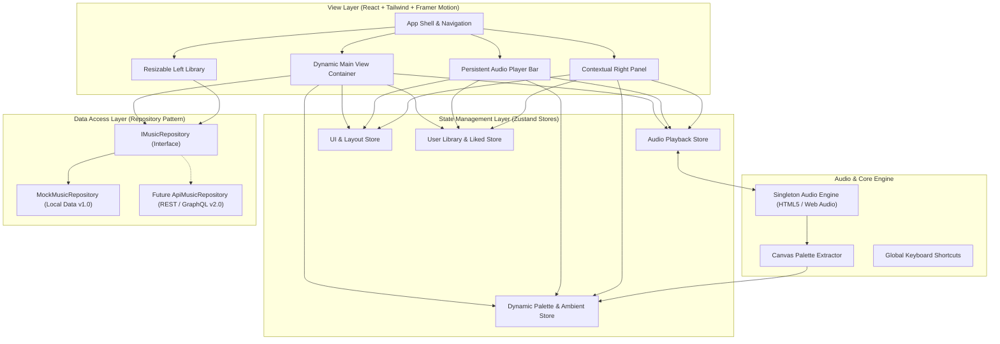
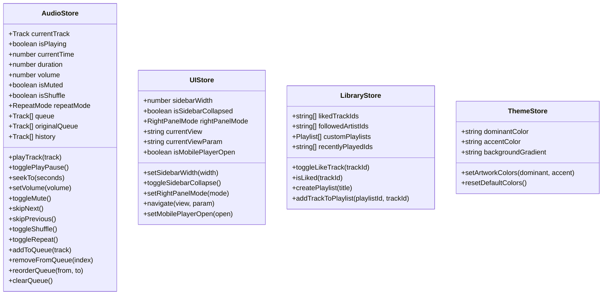
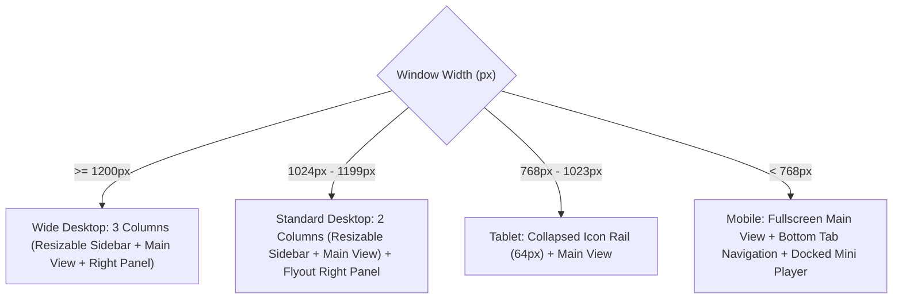

# SONORA — Technical Architecture Specification

**Document Version:** 1.0.0  
**Status:** Architectural Proposal (Awaiting Approval)  
**Author:** Senior Product Architect  
**Project Root:** `D:\SONORA`

---

## 1. System Overview & Technology Stack

SONORA is architected as an ultra-responsive, decoupled, client-side Single Page Application (SPA). The architecture isolates stateful audio streaming from the UI rendering layer to guarantee **100% uninterrupted playback** across route transitions, modal displays, and complex layout reconfigurations.



### Technology Selection Rationale

| Layer | Chosen Technology | Architecture Justification |
|---|---|---|
| **Build & Bundler** | **Vite (v6+)** | Instant hot-module replacement (HMR), tree-shaking, lightweight dev server, native ES modules. |
| **UI Framework** | **React 18 / 19** | Industry standard component lifecycle, hooks, and concurrent features. |
| **Language** | **TypeScript 5.x (Strict)** | End-to-end type safety across domain models, API contracts, store states, and component props. |
| **Styling & Design System** | **Tailwind CSS 3.4+** | Utility-first CSS with dynamic CSS variables for theme palette injection; high performance zero-runtime stylesheet generation. |
| **Primitive Components** | **shadcn/ui (Radix Primitives)** | Headless, unstyled accessible primitives (Dialog, Slider, DropdownMenu, Tooltip) ensuring strict WCAG 2.1 compliance. |
| **Animation Engine** | **Framer Motion 11+** | Declarative layout animations (`layoutId`), physics-based spring transitions for hover buttons and drawer interactions. |
| **Iconography** | **Lucide React** | Consistent 24×24 scalable SVG icon library with tree-shakeable imports. |
| **Global State** | **Zustand 4+** | Minimalistic, high-performance store allowing state subscriptions outside React render loops (critical for 60fps audio scrubber updates). |

---

## 2. Directory Structure & Modular Organization

The project will be strictly structured inside `D:\SONORA\src\` using feature-oriented and layered clean architecture:

```
D:\SONORA\
├── docs/                               # Architectural & Requirements Documentation
├── public/                             # Static public assets (fonts, default artwork, audio)
│   ├── audio/                          # Royalty-free mock audio files (.mp3/.aac)
│   └── images/                         # Curated album art & artist avatars
├── src/
│   ├── assets/                         # SVG icons, logo vectors
│   ├── components/                     # Shared Atomic & Composite UI Components
│   │   ├── ui/                         # shadcn/ui headless primitives (button, slider, dialog, tooltip)
│   │   ├── common/                     # App-specific reusable widgets (ArtworkImage, Equalizer, MarqueeText)
│   │   ├── cards/                      # Card components (TrackCard, AlbumCard, ArtistCard, CategoryCard)
│   │   ├── table/                      # Virtualized / Responsive Tracklist Table components
│   │   └── feedback/                   # Toast notifications, Skeletal loaders
│   ├── layouts/                        # Shell Layout Components
│   │   ├── AppShell.tsx                # Master 3-column + player grid shell
│   │   ├── TopNavBar.tsx               # Global search capsule and navigation controls
│   │   ├── LeftSidebar.tsx             # Resizable Library panel and draggable splitter
│   │   ├── RightCompanionPanel.tsx     # Contextual Now Playing / Lyrics / Queue panel
│   │   ├── BottomPlayerBar.tsx         # Fixed playback controller and timeline scrubber
│   │   └── MobileNavigation.tsx        # Mobile bottom tab bar & floating mini player
│   ├── views/                          # Route Page Views
│   │   ├── HomeView.tsx                # Welcome greeting, quick grid, carousels
│   │   ├── SearchView.tsx              # Category browse grid & instant search results
│   │   ├── PlaylistView.tsx            # Full playlist hero banner and tracklist table
│   │   ├── AlbumView.tsx               # Album hero banner, tracklist, and credits
│   │   ├── ArtistView.tsx              # Artist hero, popular tracks, discography, about
│   │   ├── QueueView.tsx               # Dedicated full queue manager
│   │   └── LyricsView.tsx              # Ambient full-screen synchronized lyrics view
│   ├── stores/                         # Global Zustand State Stores
│   │   ├── useAudioStore.ts            # Playback state, queue, shuffle, repeat, volume
│   │   ├── useUIStore.ts               # Layout state, sidebar width, open drawers, active tabs
│   │   ├── useLibraryStore.ts          # Liked songs, custom playlists, recent history
│   │   └── useThemeStore.ts            # Dynamic artwork palette and ambient glow colors
│   ├── services/                       # Low-Level Core Engines
│   │   ├── AudioEngine.ts              # HTMLAudioElement singleton manager and event broker
│   │   ├── PaletteService.ts           # Canvas-based dominant color extraction utility
│   │   └── KeyboardShortcutsService.ts # Global hotkey listeners (Space, Arrows, M, L, Q)
│   ├── data/                           # Local Data & Repositories
│   │   ├── mock/                       # Rich seed catalog (tracks, artists, albums, lyrics)
│   │   ├── repository/                 # Data access repository interfaces and implementations
│   │   │   ├── IMusicRepository.ts     # Data contract interface
│   │   │   ├── MockMusicRepository.ts  # v1.0 local mock implementation
│   │   │   └── ApiMusicRepository.ts   # v2.0 REST/GraphQL backend implementation
│   ├── types/                          # Domain TypeScript Models
│   │   ├── music.ts                    # Track, Album, Artist, Playlist, Genre
│   │   ├── audio.ts                    # PlaybackState, RepeatMode, QueueItem
│   │   └── theme.ts                    # ExtractedPalette, ThemeVariables
│   ├── hooks/                          # Custom React Hooks
│   │   ├── useAudioPlayer.ts           # Convenience hook wrapping audio store actions
│   │   ├── useResizable.ts             # Pointer capture drag-to-resize hook
│   │   ├── useDebounce.ts              # Query debouncer for search input
│   │   ├── useLyricsSync.ts            # Synchronized lyric auto-scroller
│   │   └── useMediaQuery.ts            # Responsive breakpoint detection
│   ├── utils/                          # Formatting & Math Helpers
│   │   ├── formatters.ts               # Time formatting (seconds -> m:ss, counts -> 1.2M)
│   │   └── colorUtils.ts               # Contrast checker, hex-to-rgb, luminance
│   ├── App.tsx                         # Root router and ambient theme provider
│   ├── main.tsx                        # DOM mount entry point
│   └── index.css                       # Tailwind directives and custom CSS variables
├── index.html                          # HTML shell with fonts and metadata
├── tailwind.config.ts                  # Tailwind theme, colors, animations
├── tsconfig.json                       # TypeScript compiler options
└── vite.config.ts                      # Vite configuration and path aliases (@/*)
```

---

## 3. Application State Management Architecture

Zustand stores are separated into single-responsibility domains to prevent unnecessary component re-renders:



### High-Frequency Audio Updates Architecture
In high-fidelity music players, updating `currentTime` on every `timeupdate` event (4–5 times per second) can cause severe React rendering lag if subscribed to naively across the entire component tree.

**SONORA Solution:**
1. The global scrubber slider subscribes directly to `useAudioStore.subscribe(state => state.currentTime)`.
2. Dedicated `<ScrubberTimeDisplay>` and `<ScrubberProgressFill>` components subscribe to micro-slices of state using Zustand shallow equality selectors, isolating DOM updates solely to the timeline elements.
3. The rest of the application shell remains completely idle during audio playback.

---

## 4. Audio Playback Engine (`AudioEngine.ts`)

The `AudioEngine` is implemented as an unmounted **Singleton Service** instantiated once at application bootstrap:

```mermaid
sequenceDiagram
    participant UI as UI Component
    participant Store as useAudioStore
    participant Engine as AudioEngine Singleton
    participant Audio as HTMLAudioElement
    participant Palette as PaletteService

    UI->>Store: playTrack(track)
    Store->>Engine: loadAndPlay(track.audioUrl)
    Engine->>Audio: src = track.audioUrl; play()
    Audio-->>Engine: onplay event
    Engine->>Store: set({ isPlaying: true })
    
    par Artwork Color Sampling
        Engine->>Palette: extractFromImage(track.album.coverUrl)
        Palette-->>Store: updateTheme(palette)
    and Playback Time Loops
        Audio-->>Engine: ontimeupdate (currentTime)
        Engine->>Store: setCurrentTime(currentTime)
    end

    Audio-->>Engine: onended event
    Engine->>Store: handleTrackEnded()
    Store->>Engine: playNextTrack()
```

### Key Audio Engine Guarantees:
- **Audio Preloading:** Preloads the next audio file in the queue when current track reaches 85% completion.
- **Smart Seek:** When `skipPrevious()` is invoked, if playback time is `> 3 seconds`, the song resets to `0:00`. If `< 3 seconds`, it jumps to the previous track.
- **Error Recovery:** On network drop or 404/403 audio source failure, emits a user-friendly toast notification ("Audio source unavailable") and gracefully advances to the next track in queue.
- **Media Session API Integration:** Full integration with `navigator.mediaSession` enabling hardware media keys (Play, Pause, Skip, Prev) and OS-level notifications (Windows Action Center, macOS Now Playing).

---

## 5. Domain Data Models (TypeScript)

```typescript
// types/music.ts

export interface Artist {
  id: string;
  name: string;
  avatarUrl: string;
  headerBannerUrl: string;
  verified: boolean;
  monthlyListeners: number;
  bio: string;
  genres: string[];
}

export interface Album {
  id: string;
  title: string;
  coverUrl: string;
  releaseDate: string; // YYYY-MM-DD
  artistId: string;
  artistName: string;
  type: 'album' | 'single' | 'ep' | 'compilation';
  tracksCount: number;
  copyright: string;
}

export interface LyricLine {
  timeMs: number; // Milliseconds from track start
  text: string;
}

export interface Track {
  id: string;
  title: string;
  durationMs: number; // Duration in milliseconds
  audioUrl: string;
  artistId: string;
  artistName: string;
  albumId: string;
  albumTitle: string;
  coverUrl: string;
  explicit: boolean;
  playsCount: number;
  lyrics?: LyricLine[];
}

export interface Playlist {
  id: string;
  title: string;
  description: string;
  coverUrl: string;
  creatorId: string;
  creatorName: string;
  tracks: Track[];
  isPublic: boolean;
  updatedAt: string;
}

export interface GenreCategory {
  id: string;
  title: string;
  bgColorHex: string;
  coverUrl: string;
  slug: string;
}
```

---

## 6. Data Access Layer & Backend Abstraction

To ensure scalability and prevent coupling UI components to mock arrays, all data retrieval goes through the `IMusicRepository` abstraction:

```typescript
// data/repository/IMusicRepository.ts

export interface IMusicRepository {
  getFeaturedShelves(): Promise<{ id: string; title: string; items: (Album | Playlist)[] }[]>;
  getQuickReplayItems(): Promise<(Album | Playlist)[]>;
  getGenreCategories(): Promise<GenreCategory[]>;
  search(query: string): Promise<{
    topResult?: Track | Artist | Album;
    tracks: Track[];
    artists: Artist[];
    albums: Album[];
    playlists: Playlist[];
  }>;
  getTrackById(id: string): Promise<Track | null>;
  getAlbumById(id: string): Promise<{ album: Album; tracks: Track[] } | null>;
  getArtistById(id: string): Promise<{ 
    artist: Artist; 
    topTracks: Track[]; 
    albums: Album[]; 
    singles: Album[]; 
  } | null>;
  getPlaylistById(id: string): Promise<Playlist | null>;
}
```

### Transition to Real Backend (Future Phase 3):
Replacing mock data with a cloud backend requires only writing `ApiMusicRepository.ts` that implements `IMusicRepository` using `fetch()` or `axios`. **Not a single UI component, store, or hook needs to be modified.**

---

## 7. Responsive Layout Grid & Breakpoints



### CSS Layout Specifications:
- **Root Shell Container:**
  ```css
  display: grid;
  grid-template-rows: auto 1fr auto; /* Global Top Nav, Main Body, Bottom Player */
  grid-template-columns: var(--sidebar-width, 300px) 1fr var(--right-panel-width, 0px);
  height: 100vh;
  overflow: hidden;
  background-color: #000000;
  gap: 8px;
  padding: 8px;
  ```
- **Draggable Splitter Hook (`useResizable`):**
  Listens to `pointermove` on the `window` after `pointerdown` on the splitter element, updating CSS custom property `--sidebar-width` directly on the root DOM element. Uses `requestAnimationFrame` for buttery-smooth 60fps resizing without triggering React re-renders.

---

## 8. Performance, Security, and Scalability Checklist

- **Bundle Optimization:** Code splitting with React `lazy()` for heavy views (`ArtistView`, `LyricsView`, `QueueView`).
- **Asset Optimization:** WebP image format with fallback, `loading="lazy"` on all cards below the fold.
- **Zero Local Injections:** All mock and API strings sanitized; dangerouslySetInnerHTML strictly prohibited.
- **State Persistence:** Local storage synchronization for user library and volume throttled at 500ms using a debounced store subscriber.
