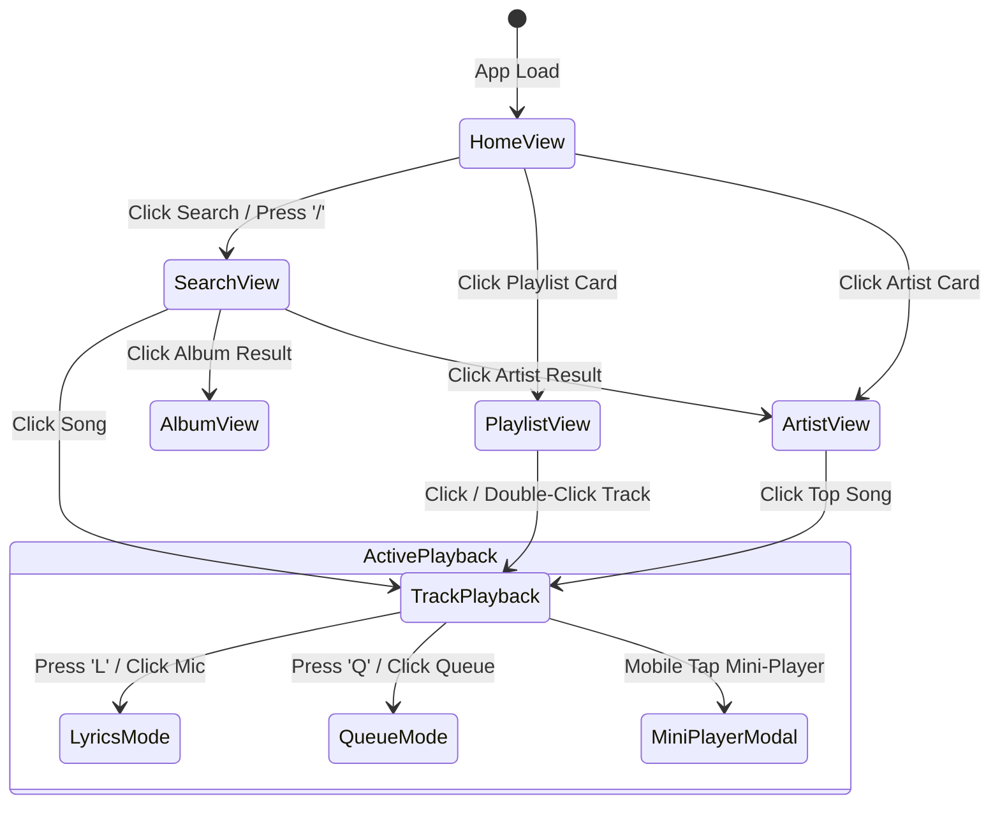
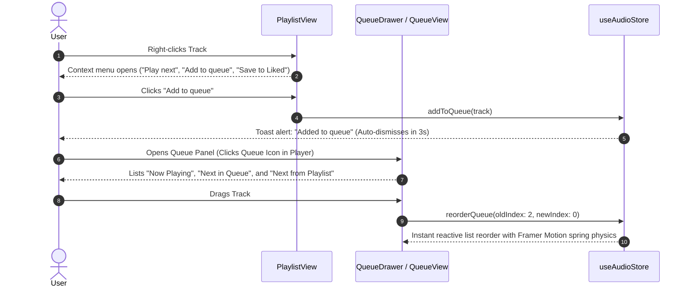

# SONORA — User Flows & Interaction Specifications

**Document Version:** 1.0.0  
**Status:** Architectural Proposal (Awaiting Approval)  
**Author:** Senior Product Architect  
**Project Root:** `D:\SONORA`

---

## 1. User Journey Overview

SONORA's user experience is centered around frictionless audio discovery, tactile micro-interactions, and continuous ambient immersion. Every journey is designed to keep music playing continuously without navigation friction.



---

## 2. Detailed User Flows

### Flow 1: First-Time Discovery & Instant Playback

**Goal:** A new or returning user visits SONORA and starts playing music within 2 clicks.

```mermaid
sequenceDiagram
    autonumber
    actor User
    participant Shell as App Shell
    participant Home as HomeView
    participant Store as useAudioStore
    participant Engine as AudioEngine
    participant Theme as ThemeStore

    User->>Shell: Opens SONORA (Desktop / Mobile)
    Shell->>Home: Mounts HomeView (Time-aware greeting)
    Home-->>User: Displays "Good evening", Quick 6-Grid, and Curated Shelves
    User->>Home: Hovers over "Trending Now" Card
    Home-->>User: Card elevates; Floating Green Play Button scales up
    User->>Home: Clicks Green Play Button
    Home->>Store: playTrack(card.firstTrack, playlistContext)
    Store->>Engine: startStream(track.audioUrl)
    Engine->>AudioElement: play()
    Engine->>Theme: extractPalette(track.coverUrl)
    Theme-->>Shell: Injects dynamic CSS gradient glow
    Engine-->>Store: Emit isPlaying: true, currentTime: 0
    Store-->>Shell: Player Bar activates with track thumbnail, title & scrubber
```

#### Step-by-Step Specification:
1. **Entry:** User lands on `https://sonora.app/` (or local root).
2. **Greeting:** System checks client local time (`new Date().getHours()`) and renders contextual greeting (`Good morning` [5–12], `Good afternoon` [12–18], `Good evening` [18–5]).
3. **Quick Replay Grid:** User sees 6 compact horizontal tiles displaying their most recent or trending items with instant play triggers.
4. **Interaction:** Hovering any card triggers spring scale (`1.05`) on the green play action button. Clicking play initiates immediate audio streaming without leaving the Home page.
5. **System Feedback:** Bottom player bar transitions from inactive placeholder to vibrant playing state; background ambient gradient smoothly cross-fades to the album's primary tone.

---

### Flow 2: Predictive Search & Multi-Entity Exploration

**Goal:** User searches for a track, artist, or mood and explores results with zero page reloads.

```mermaid
sequenceDiagram
    autonumber
    actor User
    participant Nav as TopNavBar
    participant Search as SearchView
    participant Repo as IMusicRepository
    participant Store as useAudioStore

    User->>Nav: Clicks Search Input / Presses Shortcut '/'
    Nav->>Search: Navigates to /search (Input focused)
    Search-->>User: Displays colorful Genre & Mood Browse Grid
    User->>Nav: Types "Midnight City"
    Nav->>Nav: Debounce input (200ms)
    Nav->>Repo: search("Midnight City")
    Repo-->>Search: Returns { topResult, tracks, artists, albums }
    Search-->>User: Renders Top Result card + 4 Tracks + Artists Row
    User->>Search: Clicks "Play" on Top Result Card
    Search->>Store: playTrack(topResult)
    Store-->>User: Audio plays; Nav keeps search term intact
```

#### Edge Cases & Recovery:
- **Empty Query:** Reverts immediately to the "Browse all" genre card grid.
- **No Matches Found:** Displays a clean empty state with suggestions: *"No results found for '[query]'. Check spelling or browse genres below."*
- **Clear Button:** Clicking the ('X') icon inside the search capsule clears the query and restores focus to the input field in one click.

---

### Flow 3: Immersive Synced Lyrics & Seeking

**Goal:** User sings along with real-time synced lyrics and jumps directly to a favorite chorus.

```mermaid
sequenceDiagram
    autonumber
    actor User
    participant Player as BottomPlayerBar
    participant Lyrics as LyricsView
    participant Store as useAudioStore
    participant Engine as AudioEngine

    User->>Player: Clicks Microphone Icon / Presses 'L'
    Player->>Lyrics: Opens Lyrics View (Ambient Backdrop Active)
    Lyrics-->>User: Displays synced lyrics with active line in bold white
    Engine->>Lyrics: Emits currentTime (e.g. 45.2s)
    Lyrics->>Lyrics: Computes active line index; smooth auto-scroll to center
    User->>Lyrics: Clicks future line "And we run with the shadows..." (at 1:15)
    Lyrics->>Store: seekTo(75.0)
    Store->>Engine: audio.currentTime = 75.0
    Engine-->>Lyrics: Instant update to active line; playback continues seamlessly
```

#### Key Micro-Interactions:
- **Active Lyric Typography:** Active line renders in crisp white (`32px`, bold) with a subtle glowing aura. Past lines fade to 40% opacity; upcoming lines sit at 60% opacity.
- **Click-to-Seek Feedback:** Hovering any line highlights it with an underline and changes the cursor to pointer; clicking produces an instant seek with no audio crackle or desynchronization.
- **Exit Action:** Pressing `Esc` or clicking the close button gracefully slides the lyrics view back down to the normal layout.

---

### Flow 4: Contextual Queue Management & Reordering

**Goal:** User inspects the upcoming track order, drags a song up, and enqueues additional songs from a playlist.



---

### Flow 5: Mobile Shell Navigation & Docked Mini-Player

**Goal:** User on a mobile device browses while music plays, expands the full-screen player, and dismisses it with gestures.

```mermaid
sequenceDiagram
    autonumber
    actor User
    participant MobileNav as MobileBottomBar
    participant MiniPlayer as DockedMiniPlayer
    participant ModalPlayer as FullScreenPlayerModal
    participant Store as useAudioStore

    User->>MiniPlayer: Observes playing track docked above Bottom Bar
    User->>MobileNav: Taps "Search" tab
    MobileNav-->>User: Switches to SearchView; MiniPlayer remains anchored
    User->>MiniPlayer: Taps on MiniPlayer card
    MiniPlayer->>ModalPlayer: Triggers modal slide-up transition (spring 0.4s)
    ModalPlayer-->>User: Fullscreen artwork, large scrubber, lyrics button, volume
    User->>ModalPlayer: Swipes downward on top grab handle
    ModalPlayer->>MiniPlayer: Closes modal with exit spring animation; audio uninterrupted
```

---

### Flow 6: Power User Keyboard Shortcut Navigation

| Key Combination | Scope | Action Triggered | Visual Feedback |
|---|---|---|---|
| `Space` | Global (when input not focused) | Toggle Play / Pause | Play/Pause button morphs icon |
| `ArrowRight` | Global | Seek Forward +5 Seconds | Scrubber thumb skips forward |
| `ArrowLeft` | Global | Seek Backward -5 Seconds | Scrubber thumb skips backward |
| `ArrowUp` | Global | Increase Volume +5% | Volume slider animates up |
| `ArrowDown` | Global | Decrease Volume -5% | Volume slider animates down |
| `M` | Global | Toggle Mute | Mute icon toggles |
| `L` | Global | Toggle Synced Lyrics View | Lyrics view slides open/closed |
| `Q` | Global | Toggle Queue Companion Panel | Right panel toggles queue tab |
| `/` | Global | Focus Search Input | Cursor jumps to top search bar |
| `Esc` | Modal / Panels | Close active overlay or modal | Closes current drawer/dialog |
